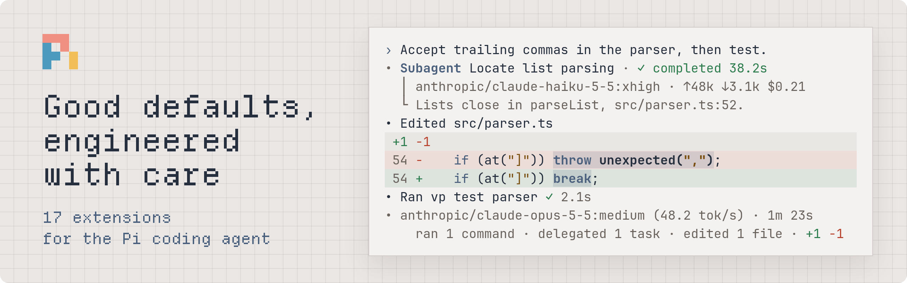

<picture>
  <source media="(prefers-color-scheme: dark)" srcset="docs/assets/hero-dark.png" />
  
</picture>

# pi-mono

[](https://www.npmjs.com/package/@earendil-works/pi-coding-agent)

pi-mono is a monorepo of opinionated [extensions](#extensions) for the [Pi coding agent](https://github.com/earendil-works/pi/tree/main/packages/coding-agent). Fork or clone it, then [adapt the extensions](#make-it-your-own) to your workflow. The workspace has instructions and skills for coding agents, so Pi can make the changes for you.

To try the extensions as they are, [install](#install) the `release` branch. It has all extensions without the development files, and Pi installs it like any other package.

Only Linux support is guaranteed. Windows and macOS are not thoroughly tested.

## Extensions

| Extension                                                                      | What it does                                                                                          |
| ------------------------------------------------------------------------------ | ----------------------------------------------------------------------------------------------------- |
| [pi-subagents](packages/extensions/pi-subagents/README.md)                     | Delegates foreground and background work to resumable Pi processes, with task views and cancellation. |
| [pi-smart-compact](packages/extensions/pi-smart-compact/README.md)             | Lets the model compact its own context mid-task, so long tasks keep going.                            |
| [pi-skills](packages/extensions/pi-skills/README.md)                           | Turns `/skill:<name>` anywhere in a prompt into a file link, with **Tab** completion.                 |
| [pi-tool-display](packages/extensions/pi-tool-display/README.md)               | Shows tool calls as compact, expandable cards with file diffs.                                        |
| [pi-nested-instructions](packages/extensions/pi-nested-instructions/README.md) | Loads `AGENTS.md` files from subdirectories when the model starts working in them.                    |
| [pi-profiles](packages/extensions/pi-profiles/README.md)                       | Switches the model, thinking level, tools, and instructions together with one key.                    |
| [pi-fff-guard](packages/extensions/pi-fff-guard/README.md)                     | Stops FFF searches that would silently find nothing in ignored or missing paths.                      |
| [pi-null-args](packages/extensions/pi-null-args/README.md)                     | Drops optional tool arguments that a model sent as the text `"null"`, so Pi doesn't reject the call.  |
| [pi-read](packages/extensions/pi-read/README.md)                               | Lets the model select and highlight an exact span of a file when reading it.                          |
| [pi-model-prompt](packages/extensions/pi-model-prompt/README.md)               | Appends different system instructions depending on the model.                                         |
| [pi-todo](packages/extensions/pi-todo/README.md)                               | Gives the model a todo list, shown in a widget and a `/todos` browser and saved in the session.       |
| [pi-prompt-manager](packages/extensions/pi-prompt-manager/README.md)           | Keeps searchable prompt history and saved drafts per directory.                                       |
| [pi-session-utils](packages/extensions/pi-session-utils/README.md)             | Saves unsaved sessions, starts empty child sessions, and names sessions automatically.                |
| [pi-abort-guard](packages/extensions/pi-abort-guard/README.md)                 | Stops a running agent only on a second **Escape**, so one stray press doesn't end the turn.           |
| [pi-agent-summary](packages/extensions/pi-agent-summary/README.md)             | Adds a one-line summary after each run: time, models, commands, and changed files.                    |
| [pi-editor-widgets](packages/extensions/pi-editor-widgets/README.md)           | Moves widgets and statuses above the editor, below it, or into the footer.                            |
| [pi-prompt-cloak](packages/extensions/pi-prompt-cloak/README.md)               | Rewrites two Pi-specific system prompt lines to reduce fingerprinting by upstream providers.          |

## Make it your own

To change the extensions, remove them, or add your own, fork or clone this repository and develop in it. The workspace is the source of the `release` branch, so your copy has the same extensions, tests, and checks.

### Setup

Use Node.js from [.node-version](.node-version) and the [Vite+ CLI (`vp`)](https://viteplus.dev/guide/). From the repository root:

```sh
vp install --frozen-lockfile
```

Pi loads extensions from their TypeScript source, so there's no build step.

### Load an extension

Run the workspace copy of Pi with an extension directory:

```sh
vp exec pi -e ./packages/extensions/pi-tool-display
```

Repeat `-e` to load more extensions. To keep extensions loaded across launches, use Pi's [package installation](https://pi.dev/docs/latest/packages#install-and-manage-packages).

Links to published Pi documentation point to the latest version, which can be newer than the version that this workspace uses. Maintainers can check the [installed API references](docs/agents/pi-docs.md) for the pinned version.

### Install your build

Each push to `master` runs the [release workflow](docs/development.md#release-branch), which checks the workspace and builds the `release` branch. In your own repository, it builds your own `release` branch. [Install](#install) that branch with your repository in place of `pnd280/pi-mono`. GitHub turns off workflows in a new fork until you enable them on its Actions tab.

### Development

| When you…                                     | Read                                                                                                                                   |
| --------------------------------------------- | -------------------------------------------------------------------------------------------------------------------------------------- |
| Run checks, edit tooling, or add dependencies | [Development](docs/development.md)                                                                                                     |
| Write extension code against Pi's API         | Pi's [extension documentation](https://pi.dev/docs/latest/extensions), then the workspace's [Pi API contracts](docs/agents/pi-apis.md) |
| Find the package that owns a feature          | [Architecture](docs/architecture.md)                                                                                                   |

## Install

Install all extensions as one Pi package from the `release` branch:

```sh
pi install git:github.com/pnd280/pi-mono@release
```

To try the extensions for one session without installing them, run `pi -e git:github.com/pnd280/pi-mono@release`.

To load only some extensions, install the package and turn the others off with `pi config`. Or list the extensions to load in `~/.pi/agent/settings.json`:

```json
{
  "packages": [
    {
      "source": "git:github.com/pnd280/pi-mono@release",
      "extensions": ["extensions/pi-todo/index.ts", "extensions/pi-read/index.ts"]
    }
  ]
}
```

Write each path in full, because `index.ts` alone matches every extension. Pi's [package filters](https://pi.dev/docs/latest/packages#select-package-resources) describe the other pattern forms.

`pi update --extensions` moves the installation to the newest `release` commit. `pi update` alone updates only Pi. Pi counts a source with a branch as pinned, so it doesn't report new commits at startup.

To stay on one version, install its tag, such as `git:github.com/pnd280/pi-mono@v0.1.0`. `pi update --extensions` keeps a tag; to change the version, install another tag. To stay on a build between versions, install its commit with the full 40-character hash. Pi fetches the ref again on update, and Git can't fetch an abbreviated hash.

With all extensions loaded, Pi shows two warnings at each start. pi-profiles replaces Pi's built-in `tool-search` extension; its [tool search](packages/extensions/pi-profiles/README.md#tool-search) section tells how to stop the warning. pi-prompt-manager takes **Ctrl+R** from session renaming; its [configuration](packages/extensions/pi-prompt-manager/README.md#configuration) sets other keys.
