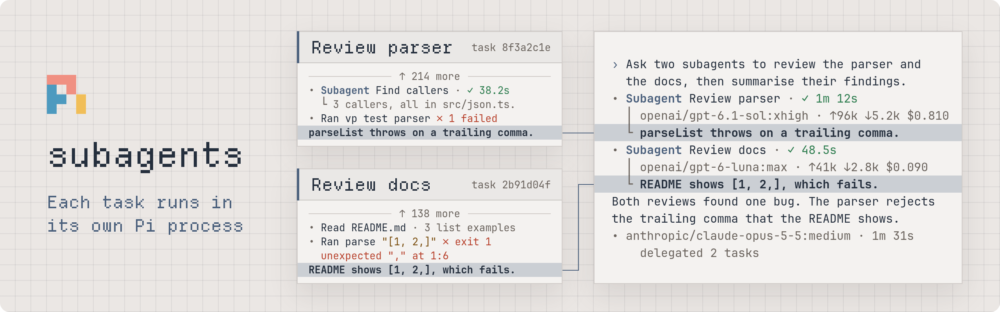

<picture>
  <source media="(prefers-color-scheme: dark)" srcset="docs/assets/banner-dark.png" />
  
</picture>

# pi-subagents

Long reviews and parallel investigations fill one conversation with every intermediate step. pi-subagents runs each piece as a task in a separate Pi process and returns only its final result to your conversation, with configurable nesting depth, capacity, and result delivery, task templates, optional background shell jobs, a task panel, the position of its "Waiting for background results" working message, and your own instructions for the `subagent` tool.

For example, send this prompt:

```text
Ask two subagents to review the parser and the documentation, then summarise their findings.
```

## Controls

| Control                           | Effect                                                                                                                                                                                                                                                                                                                     |
| --------------------------------- | -------------------------------------------------------------------------------------------------------------------------------------------------------------------------------------------------------------------------------------------------------------------------------------------------------------------------- |
| **Ctrl+Alt+S**                    | Open the [task panel](docs/interface.md#task-panel) in TUI mode. Change the key with `shortcut`.                                                                                                                                                                                                                           |
| `/subagents`                      | Open the task panel in TUI mode. In RPC mode, return the first JSON page.                                                                                                                                                                                                                                                  |
| `/subagents list`                 | Return a JSON page of tasks. The other subcommands `show`, `abort`, `jobs`, and `background` show, cancel, list jobs, and move work to the background; see [commands](docs/commands.md).                                                                                                                                   |
| Left click on a task or job card  | In fullscreen mode, open the task's transcript viewer or the job's log viewer, instead of Pi's normal card expansion; see [widget](docs/interface.md#widget).                                                                                                                                                              |
| Left click on the widget          | In fullscreen mode, open the task panel.                                                                                                                                                                                                                                                                                   |
| `/working-message`                | Reorder the "Background wait" item, which shows "Waiting for background results" in the TUI working message, and save the order. This extension or another extension that uses the working message registers the command; see [waiting for background results](docs/background-results.md#waiting-for-background-results). |
| `subagent` model tool             | Start a task with a short `description` and a detailed `prompt`, or continue a task with `task_id`. A foreground call waits for completion. With `background: true`, the call returns the task ID after capacity is available and the child starts, and the result arrives automatically. Hidden at `maxDepth`.            |
| `subagent_abort` model tool       | Cancel an active task that the session owns, by `task_id`. The task session remains resumable; see [cancel a task](docs/tasks.md#cancel-a-task). Hidden at `maxDepth`.                                                                                                                                                     |
| `job` and `job_abort` model tools | Start a shell command in the background, or stop it. The result arrives like a task result, with the exit code and the end of the output. Only when `jobs` is `true`; see [background jobs](docs/jobs.md).                                                                                                                 |

The tools are model-only, so codemode scripts cannot invoke them.

## Usage

Your current Pi session is the supervisor. Each child runs in the same working directory. A new task starts with a fresh conversation, so its prompt must supply the context that the child needs; a resume continues the task's conversation. Keep parallel edits in different files. The child's system prompt tells it that only its final reply returns; see [result instructions](docs/children.md#result-instructions).

- Set `task_id` to continue a task: an inactive task resumes, and an active task receives input. See [send input or resume](docs/tasks.md#send-input-or-resume).
- Set `model` to `provider/id` to select a model. See [model and thinking](docs/tasks.md#model-and-thinking).
- Set `launch_args` to give the child more Pi CLI arguments, such as `["--no-extensions", "-e", "path"]`. See [launch arguments](docs/tasks.md#launch-arguments).
- Set `template` to fill in the values that a launch or resume leaves out from a template in the `templates` setting. The `subagent` description lists the templates. See [templates](docs/tasks.md#templates).
- A turn abort stops running foreground work, and tree navigation, fork, and session switch stop all running work. Restored tasks never restart automatically. See [turn aborts](docs/tasks.md#turn-aborts) and [branch changes](docs/history.md#branch-changes).
- Top-level launches queue in FIFO order when capacity is full. Nested launches fail immediately with the configured capacity in the error, so a task never waits for capacity that its own ancestors hold.

Use background tasks only for independent work, and wait for their automatic result instead of polling or duplicating their work. By default, a ready result joins the run after the model's reply and its tool calls, before the next model request. After a normal reply, the supervisor stays busy while its direct background tasks run, until new input or an abort. See [background results](docs/background-results.md).

In the task panel, the list shows task trees and jobs, and **Enter** opens a read-only transcript or log viewer. See [task panel, viewers, and cards](docs/interface.md).

Limits:

- Force-kill does not reverse file changes and can bypass child cleanup. See [process shutdown limits](docs/shutdown.md#limits).
- In a job, keep each process in the foreground of its command. See [job limits](docs/jobs.md#limits).
- Tool output is truncated with Pi's defaults of 2,000 lines and 50 KiB.
- Linux has automated coverage. macOS uses the same process-group path but has not been verified. Windows code paths are untested and not officially supported.
- For the depth-limit and SDK-host limits of children, see [child process limits](docs/children.md#limits).

## Configuration

Put the `ext.pi-subagents` section in Pi's global `~/.pi/agent/settings.json` (or `$PI_CODING_AGENT_DIR/settings.json`), in `.pi/settings.json` in the current directory of a [trusted project](https://pi.dev/docs/latest/security#understand-project-trust), or in both. Valid trusted-project values override global values, and invalid values are ignored. Settings load at session start and at `/reload`, so run `/reload` after you edit settings or a docs file. See Pi's [settings reference](https://pi.dev/docs/latest/settings) for its own settings.

This example shows every field with its default, except `docs` and `templates`, which have no default. Remove the comments before you copy it, because Pi reads `settings.json` as plain JSON:

```jsonc
{
  "ext.pi-subagents": {
    // Optional. An integer from 0 to 100. 0 disables launches; 2 permits children and grandchildren. Default: 2.
    "maxDepth": 2,
    // Optional. An integer from 1 to 100 that limits the whole live task tree, including reserved launches and stopping processes. Default: 8.
    "maxConcurrent": 8,
    // Optional. A non-negative integer that limits the launches that wait for capacity in FIFO order. 0 rejects a launch when all slots are occupied. Default: 8.
    "maxQueued": 8,
    // Optional. true gives the model the job and job_abort tools. Default: false.
    "jobs": false,
    // Optional. When task and job results reach a busy supervisor: "turn_end" or "settle". Default: "turn_end". See docs/background-results.md#delivery-timing.
    "resultDelivery": "turn_end",
    // Optional. The key that opens the task panel, in Pi key syntax. A modified Esc is invalid. Default: "ctrl+alt+s".
    "shortcut": "ctrl+alt+s",
    // Optional. Markdown files whose text is added to the subagent tool description. Default: no docs. A relative path resolves from the directory of this settings file. Each file is at most 1 MiB. A project list replaces the global list, and an empty array removes the docs.
    "docs": ["prompts/subagent.md"],
    // Optional. Named default values for new tasks and resumes; a call sets `template` to use one. Default: no templates. For merge and validation rules, see docs/tasks.md#template-settings. Each entry is a template object, or the path of a JSON file that holds one template object. A relative path resolves from the directory of this settings file.
    "templates": [
      "templates/reviewer.json",
      {
        // Required. A lowercase letter, then lowercase letters, digits, or hyphens.
        "name": "scout",
        // Required. Tells the model when to use the template. At least one character that is not white space.
        "description": "File and symbol discovery, narrow test runs.",
        // Optional. A provider/id model. Default: none; the call's default applies.
        "model": "openai/gpt-5-mini",
        // Optional. "off", "minimal", "low", "medium", "high", "xhigh", or "max". Default: none; the call's default applies.
        "thinking": "low",
        // Optional. true starts the task in the background. Default: false.
        "background": false,
        // Optional. Pi CLI arguments, always added after the call's launch_args. At most 32 items of at most 2,048 characters. Nothing expands $VAR. Default: no arguments.
        "launchArgs": ["--tools", "read,bash"],
        // Optional. Files that the child adds to its system prompt. A relative path resolves from the directory of the file that holds the template. Each file must be readable when settings load. At most 32 items of at most 2,048 characters. Default: no files.
        "appendSystemPrompts": ["prompts/scout.md"]
      }
    ]
  }
}
```

For key names, see [Pi key syntax](https://pi.dev/docs/latest/keybindings#key-syntax). For how `docs` files are read and the warnings for invalid ones, see [subagent tool docs](docs/tool-docs.md).

## Side effects

- Children have normal Pi tools and permissions, with no read-only mode and no workspace isolation. They inherit the environment, working directory, and project-trust decision; see [child processes](docs/children.md).
- Each task saves one Pi session for the child, and the child adds a `pi-subagents.marker` entry at the start of each run. Child session files are not automatically deleted.
- The supervisor adds two small entries for each run and for each job, whatever the child or the command writes.
- While a run is live, a `<session_file>.lease/` directory blocks other resumes of the task. See [writer lease](docs/history.md#writer-lease).
- Child model calls can incur provider charges. Usage after a background call returns reaches supervisor totals only when its result is delivered; see [usage accounting](docs/background-results.md#usage-accounting).
- Successful compaction adds a hidden reminder of direct task IDs, and of jobs when `jobs` is on, without starting a new turn.
- Each job writes to `pi-job-<job_id>.log` in the OS temporary directory. Files are not automatically deleted. See [log files](docs/jobs.md#log-files).
- Saving in `/working-message` writes the order to the global or trusted project `settings.json` shown in the menu, and keeps other settings.

## Docs

| When you…                                                         | Read                                                               |
| ----------------------------------------------------------------- | ------------------------------------------------------------------ |
| Send input to a task, resume it, pick its model, or cancel it     | [Continue and cancel tasks](docs/tasks.md)                         |
| Need to know what a child inherits and which extensions it loads  | [Child processes](docs/children.md)                                |
| Need to know when background results arrive and how waits work    | [Background results](docs/background-results.md)                   |
| Turn on background shell commands                                 | [Background jobs](docs/jobs.md)                                    |
| Script `/subagents` or read its JSON pages and transcript digests | [Commands](docs/commands.md)                                       |
| Use the task panel, viewers, tool cards, or widget                | [Task panel, viewers, and cards](docs/interface.md)                |
| Navigate, fork, or resume and want to know what a task keeps      | [Task history and branches](docs/history.md)                       |
| Need to know how and when child processes stop                    | [Process shutdown](docs/shutdown.md)                               |
| Add your own instructions to the `subagent` tool                  | [Subagent tool docs](docs/tool-docs.md)                            |
| Change behaviour or add tests                                     | [Test coverage](docs/testing.md)                                   |
| Launch the offline terminal fixture                               | [Terminal fixture](docs/validation.md#launch-the-terminal-fixture) |
| Check cards, the panel, or viewers manually                       | [Terminal checks](docs/validation.md)                              |
| Write or change e2e fixtures                                      | [Test fixtures](validation/README.md)                              |
| Upgrade Pi                                                        | [Maintainer compatibility checklist](docs/pi-compatibility.md)     |
