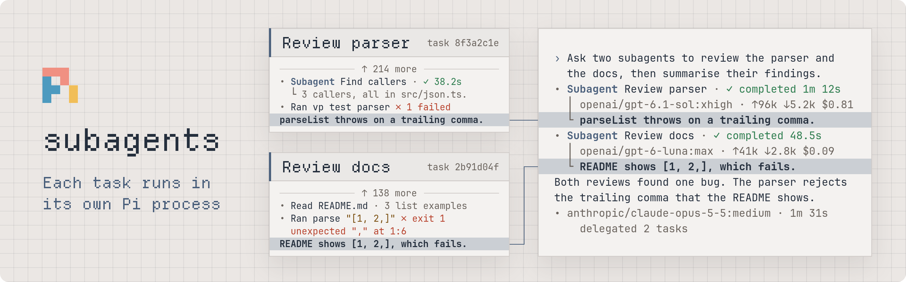

<picture>
  <source media="(prefers-color-scheme: dark)" srcset="docs/assets/banner-dark.png" />
  
</picture>

# pi-subagents

Long reviews and parallel investigations fill one conversation with every intermediate step. pi-subagents runs each piece in a separate Pi process and returns only its final result to your conversation. For example, send this prompt:

```text
Ask two subagents to review the parser and the documentation, then summarise their findings.
```

| When you…                                                         | Read                                                |
| ----------------------------------------------------------------- | --------------------------------------------------- |
| Send input to a task, resume it, pick its model, or cancel it     | [Continue and cancel tasks](docs/tasks.md)          |
| Need to know what a child inherits and which extensions it loads  | [Child processes](docs/children.md)                 |
| Need to know when background results arrive and how waits work    | [Background results](docs/background-results.md)    |
| Turn on background shell commands                                 | [Background jobs](docs/jobs.md)                     |
| Script `/subagents` or read its JSON pages and transcript digests | [Commands](docs/commands.md)                        |
| Use the task panel, viewers, tool cards, or widget                | [Task panel, viewers, and cards](docs/interface.md) |
| Navigate, fork, or resume and want to know what a task keeps      | [Task history and branches](docs/history.md)        |
| Need to know how and when child processes stop                    | [Process shutdown](docs/shutdown.md)                |
| Add your own instructions to the `subagent` tool                  | [Subagent tool docs](docs/tool-docs.md)             |

## Usage

Your current Pi session is the supervisor. Its model calls `subagent` with a short `description` and a detailed `prompt`. Foreground calls wait for completion; `background: true` returns a task ID and delivers the result automatically. Each child starts with a fresh conversation in the same working directory. Supply the context it needs, and keep parallel edits in different files.

- Set `task_id` to continue a task: an inactive task resumes, and an active task receives input. See [send input or resume](docs/tasks.md#send-input-or-resume).
- Omit `model` and `thinking` to use the supervisor's current selection, or set `model` to `provider/id`. See [model and thinking](docs/tasks.md#model-and-thinking).
- A turn abort stops running foreground work, and tree navigation, fork, and session switch stop all running work. Restored tasks never restart automatically. See [turn aborts](docs/tasks.md#turn-aborts) and [branch changes](docs/history.md#branch-changes).

The tools are model-only, so codemode scripts cannot invoke them. At `maxDepth`, `subagent` and `subagent_abort` are hidden. When `jobs` is off, `job` and `job_abort` are hidden.

### Background tasks

Use background tasks only for independent work, and wait for their automatic result instead of polling or duplicating their work. By default, a ready result joins the run after the model's reply and its tool calls, before the next model request. After a normal reply, the supervisor stays busy while its direct background tasks run, until new input or an abort. See [background results](docs/background-results.md).

### Cancel a task

The model calls `subagent_abort` with a `task_id` to cancel an active owned task. The task session remains resumable. See [cancel a task](docs/tasks.md#cancel-a-task).

### Background jobs

Set [`jobs`](#configuration) to `true` to give the model the `job` and `job_abort` tools. A job runs one shell command in the background, such as a build or a test server, and its result arrives like a task result, with the exit code and the end of the output. A job is not a task: it has no child, no capacity slot, no model, and no usage. See [background jobs](docs/jobs.md).

### Commands and task panel

Press the [`shortcut`](#configuration), **Ctrl+Alt+S** by default, or run `/subagents` to open the task panel in TUI mode; elsewhere, `/subagents` returns the first JSON page. The panel lists task trees and jobs, and **Enter** opens a read-only transcript or log viewer. Other `/subagents` subcommands list, show, abort, and move work to the background. See [commands](docs/commands.md) and [task panel, viewers, and cards](docs/interface.md).

## Configuration

Add `ext.pi-subagents` to Pi's global `settings.json` or the trusted project's `.pi/settings.json`. This example shows the default limits, jobs turned off, the default result delivery, the default shortcut, and one docs file:

```json
{
  "ext.pi-subagents": {
    "maxDepth": 2,
    "maxConcurrent": 8,
    "maxQueued": 8,
    "jobs": false,
    "resultDelivery": "turn_end",
    "shortcut": "ctrl+alt+s",
    "docs": ["prompts/subagent.md"]
  }
}
```

| Setting          | Meaning                                                                                                                                                                             |
| ---------------- | ----------------------------------------------------------------------------------------------------------------------------------------------------------------------------------- |
| `maxDepth`       | A non-negative integer. `0` disables launches; `2` permits children and grandchildren.                                                                                              |
| `maxConcurrent`  | A positive integer limiting the whole live task tree, including reserved launches and stopping processes.                                                                           |
| `maxQueued`      | A non-negative integer limiting launches waiting for capacity in FIFO order. `0` rejects a launch when all slots are occupied.                                                      |
| `jobs`           | A boolean. `true` gives the model the `job` and `job_abort` tools. The default is `false`. See [background jobs](docs/jobs.md).                                                     |
| `resultDelivery` | `turn_end` (the default) or `settle`. Sets when task and job results reach a busy supervisor; see [delivery timing](docs/background-results.md#delivery-timing).                    |
| `shortcut`       | A key in [Pi key syntax](https://pi.dev/docs/latest/keybindings#key-syntax) that opens the task panel. The default is `ctrl+alt+s`. See [task panel](docs/interface.md#task-panel). |
| `docs`           | An array of Markdown file paths. Their text is added to the `subagent` tool description. See [subagent tool docs](docs/tool-docs.md).                                               |

Settings load at session start and `/reload`. Valid trusted-project values override global values; invalid values are ignored. See Pi's [settings reference](https://pi.dev/docs/latest/settings) for its own settings.

Top-level launches queue FIFO when capacity is full. Nested launches fail immediately with the configured capacity in the error; a task never waits for capacity held by its own ancestors.

## Side effects

- Children have normal Pi tools and permissions, with no read-only mode and no workspace isolation. They inherit the environment, working directory, and project-trust decision; see [child processes](docs/children.md).
- Each task saves one Pi session for the child, and the child adds a `pi-subagents.marker` entry at the start of each run. Child session files are not automatically deleted.
- The supervisor adds two small entries for each run and for each job, whatever the child or the command writes.
- While a run is live, a `<session_file>.lease/` directory blocks other resumes of the task. See [writer lease](docs/history.md#writer-lease).
- Child model calls can incur provider charges. Usage after a background call returns reaches supervisor totals only when its result is delivered; see [usage accounting](docs/background-results.md#usage-accounting).
- Successful compaction adds a hidden reminder of direct task IDs, and of jobs when `jobs` is on, without starting a new turn.
- Each job writes to `pi-job-<job_id>.log` in the OS temporary directory. Files are not automatically deleted. See [log files](docs/jobs.md#log-files).

### Limits

- Force-kill does not reverse file changes and can bypass child cleanup. See [process shutdown limits](docs/shutdown.md#limits).
- In a job, keep each process in the foreground of its command. See [job limits](docs/jobs.md#limits).
- Tool output is truncated using Pi's 2,000-line and 50 KiB defaults.
- Linux has automated coverage. macOS uses the same process-group path but has not been verified. Windows code paths are untested and not officially supported.
- For depth-limit and SDK-host limits of children, see [child process limits](docs/children.md#limits).

## Validation

For maintainers, the offline e2e suite checks cleanup with real Pi processes and Linux `/proc`. For the manual terminal checks, run from the repository root:

```sh
vpr 'pi-subagents#validate:terminal' regular
```

Use `fullscreen` for Pi's fullscreen mode. The launcher turns on `jobs`. It prints a disposable workspace path and retains it for replay with `--reuse <directory>`. Exit Pi and check that its processes have stopped before removing that directory.

| When you…                                   | Read                                                           |
| ------------------------------------------- | -------------------------------------------------------------- |
| Change behaviour or add tests               | [Test coverage](docs/testing.md)                               |
| Check cards, the panel, or viewers manually | [Terminal checks](docs/validation.md)                          |
| Write or change e2e fixtures                | [Test fixtures](validation/README.md)                          |
| Upgrade Pi                                  | [Maintainer compatibility checklist](docs/pi-compatibility.md) |
